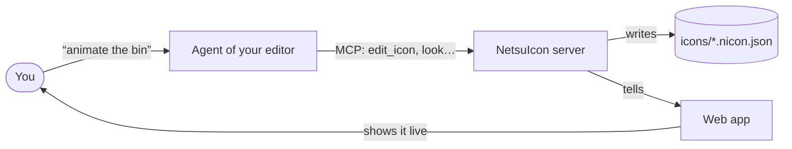
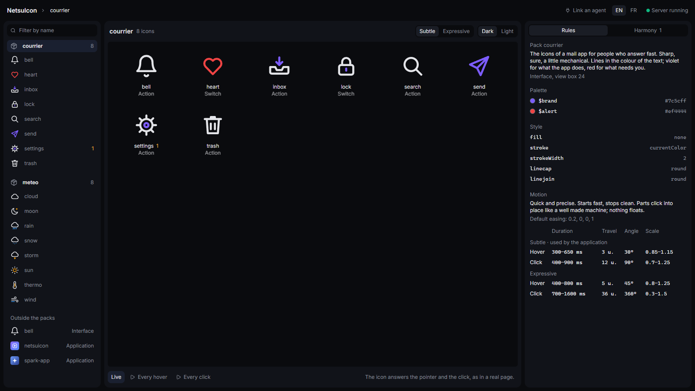
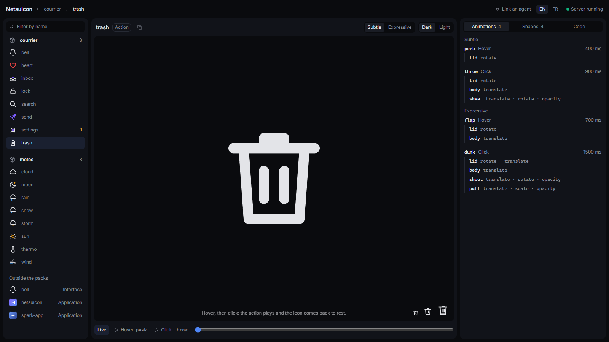

<div align="center">
  
  <h1>NetsuIcon</h1>
  <p><b>Animated icons, made by talking to an agent.</b><br>
  The agent of your code editor draws and animates the icon through a local MCP server; you watch it change live, then take the code.</p>
  <p><a href="#quick-start">Quick start</a> · <a href="#what-an-icon-can-do">What an icon can do</a> · <a href="#the-agents-tools">Tools</a> · <a href="#where-the-project-stands">Status</a></p>
</div>



The sixteen example icons of `icons/`, playing their click by themselves. In a page, they answer the pointer.

## Quick start

You need Node and pnpm.

```bash
pnpm install
pnpm dev
```

The app opens on `http://localhost:1440`; the server listens on `127.0.0.1:6210` only. In this folder, Claude Code offers the server from `.mcp.json`. From another project:

```bash
claude mcp add --transport http netsuicon http://127.0.0.1:6210/mcp
```

Any agent that speaks MCP over HTTP works the same way. Then ask, for instance:

- "make a bell icon that rings on hover";
- "make a pack for my weather app, calm, thin strokes, then the sun, rain and wind icons";
- "the `send` icon of the `courrier` pack: make the plane really take off on click";
- "design the application icon of my app, and export it for iOS and Android".

## How it works



An icon is one file, `<name>.nicon.json`: a tree of shapes and animations called clips. The agent never rewrites it: it sends small operations (`add_node`, `set_clip`, `set_track`…), all applied or none, so a saved icon can always be drawn and exported. It checks its work with pictures: the icon at rest, or the key moments of every clip side by side.

## What an icon can do

| | |
|---|---|
|  | **Two reactions.** On hover the icon hints at what it does: the lid lifts a little. On click it does it: the lid opens, a sheet falls in, the lid shuts. The sheet is a prop, there only during the click. |
|  | **Three types.** An **action** is done and over (delete, send) and comes back to rest. A **switch** keeps its state (the padlock stays open) until the next click. A **state** lasts with no press (a loader). |
|  | **Two manners.** **Subtle**: one small, short idea, for an interface people work in. **Expressive**: the same idea as a short scene (wind-up, act, aftermath). An icon can carry both; an export writes one. |

**Movement that looks real.** Before animating, the agent says how the thing works: where the moving part is held, what drives it (a hand, gravity, a spring, a motor, wind), what it is made of. A plastic lid lifted by a hand does not start like a steel padlock let go by a spring.

**Packs.** The icons of one application live in `icons/<pack>/` with a `pack.json` that sets what they share: the **style** (stroke width, ends), a **palette** of named colours (`$name`), and the **motion** (its character, the default easing, how far a hover or a press may go, in each manner). Icons copy none of it: change the pack and every icon follows. An icon that departs from its pack is reported, as advice, not an error.

**Application icons.** The `app` mode draws full bleed in a view box of 1024, with fills and gradients; each platform cuts its own shape (iOS squircle, macOS, Android circle). `proof` tests an icon in one picture: every platform, a dark screen, no colour, blurred, at 64, 32 and 16 px, and beside the three logos it looks most like in a library of 1,432 real logos. `export_app` writes the files of iOS, macOS (`.icns`), Windows (`.ico`), Android (adaptive layers) and the web (favicons, manifest).

The logo library is [kaankiziltug/logo-design-skill](https://github.com/kaankiziltug/logo-design-skill). Its logos are trademarks of their owners, studied and never copied, and not in this repository: `pnpm --filter @netsuicon/server library` downloads them.

## The exported code

| Export | What you get |
|---|---|
| Animated SVG | One file, CSS `@keyframes`, no script. Hover works alone; for a press the page sets `data-play` (an action plays whole) or `data-state="on"` / `"off"` (a switch) on the `<svg>`. |
| React | A component on `motion/react` that handles hover, press and state itself. |
| Still SVG | The icon at rest. |
| Page of a pack | One self-contained HTML file where every icon of a pack answers the pointer. |
| Application icon | The files of every platform, with `export_app`. |

The pack's colours and style are written in: the code no longer needs the pack. When the reader's system asks for less motion, the SVG stops moving and a switch still changes state.

## The app

<table><tr>
<td></td>
<td></td>
</tr></table>

- **Left**: the packs and their icons, filtered by name.
- **Middle**: the sheet of a pack, every icon alive, with buttons that replay every hover or every click; or one icon, which answers the pointer as in a real page, with one clip replayed, a scrubber, two backgrounds and its real sizes.
- **Right**: for an icon, its animations, its shapes and its code; for a pack, its rules and, in the Harmony tab, the icons that depart from them.

Every icon has its own address (`#/courrier/trash`) and a button that copies its reference for the agent. The app speaks English and French; the agent sets it to the language you write in.

## The agent's tools

Sixteen MCP tools. `guide` gives the format and the rules, once; it is all the agent knows.

| Group | Tools |
|---|---|
| Read | `list_icons`, `get_icon`, `get_pack` |
| See | `look` (an icon at rest, or moments of a clip), `look_pack` (a whole pack in one picture) |
| Write | `create_icon`, `edit_icon`, `create_pack`, `edit_pack` |
| Application icons | `proof`, `search_library` |
| Export | `export_icon`, `export_pack`, `export_app` |
| App | `set_language` |

Without an MCP connection, from a terminal: `pnpm --filter @netsuicon/server mcp look_pack '{"pack":"meteo"}' meteo.png`.

## The skills

The guide gives the format; the method lives in two skills, written for an agent that has only them and the tools:

- [`netsu-icon-motion`](skills/netsu-icon-motion): animating an interface icon after how the thing it draws works.
- [`netsu-app-icon`](skills/netsu-app-icon): designing an application icon: brief, the clichés of the category set aside, eight ideas, three built and proved, the user's choice, export.

Give those folders to your agent like any skill (with Claude Code, copy them into `.claude/skills/`). Both are also published in [NetsuSkills](https://github.com/NetsumaInfo/NetsuSkills).

## Where the project stands

- [x] **Interface icons**: two reactions, three types, two manners; sixteen examples animated and reviewed by agents that had only the skill and the tools.
- [x] **Packs**: shared style, palette and motion; departures reported.
- [x] **Exports**: animated SVG, React, still SVG, page of a pack. The React component is tested but not yet mounted in a real project.
- [x] **Application icons**: `proof`, the logo library, exports for five platforms, a skill. No exported file has been loaded into Xcode or Android Studio yet.
- [x] **The icon of this app**, from the Netsu mascot ([`mascot/`](mascot)), drawn by hand in SVG. Weak at 16 px.
- [ ] Drawing by hand in the app, a chat inside the app, Lottie export, morphing one path into another.

There is no GIF, on purpose: an interface icon is a vector, and the preview is exactly the exported file. The examples were animated by agents, which judge a movement on still frames: expect to retouch the rhythm by eye. What is verified and what is not: [`docs/STATUS.md`](docs/STATUS.md).

## Development

```bash
pnpm check   # types everywhere, same labels in every language
pnpm test    # vitest: the core and the MCP tools
pnpm --filter @netsuicon/server readme   # the pictures of this page, after an icon changed
```

Three packages: `core` (the document, the operations, the exports; pure TypeScript for the browser and the server), `server` (the MCP server and the folder of icons), `app` (the web app). Rules for working in the repository, for a person or an agent: [`AGENTS.md`](AGENTS.md). Read [`CONTRIBUTING.md`](CONTRIBUTING.md) first; security reports go through [`SECURITY.md`](SECURITY.md), never a public issue.

**Sister projects**: [NetsuFont](https://github.com/NetsumaInfo/NetsuFont) makes fonts the same way; [NetsuSkills](https://github.com/NetsumaInfo/NetsuSkills) publishes the skills.

## License

MIT. See [`LICENSE`](LICENSE).
